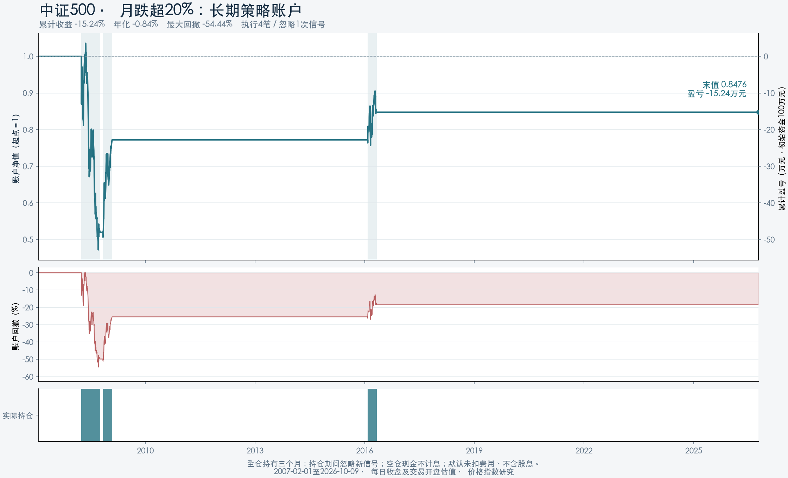

# 市场情景研究工作台

[在线访问](https://ada52705.github.io/market-scenario-lab/) · [研究口径](docs/研究说明.md) · [长期账户规则](docs/长期策略账户说明.md)

当前工作台只研究“滚动窗口回撤”的历史表现，可选持有1个月、3个月、6个月、1年，默认一个月。自然月急跌场景已于2026-10-12移出工作台；原始底稿与Python归档核验保留。单次事件研究与同一笔资金的长期回测分别呈现。界面、图表和研究说明使用简体中文。



## 当前功能

- 10个指数：上证综指、沪深300、中证500、中证1000、中证2000、上证50、深证成指、创业板指、中证红利、科创50。
- 四档窗口回撤：严格超过10%、15%、20%、25%，按窗口内最高收盘至当日收盘计算。
- [滚动窗口回撤](docs/滚动窗口研究说明.md)：3、5、10、20、25个交易日内最高收盘至当日收盘首次跌破阈值，下一交易日开盘买入，默认持有一个日历月。
- 滚动回撤可选择四档持有期；设置完参数后点击“生成结果”更新账户和事件研究。
- 全历史含回溯、发布后交易日、近十年、共同发布后区间；起始月份支持大窗口年月选择与常用起点。
- 独立的[胜率与赔率分析](docs/胜率与赔率说明.md)：区分单次事件与账户已平仓交易，展示盈利、亏损、零收益样本、平均盈亏与赔率；矩阵同步显示赔率。月收益热图仅作市场背景。
- 单一资金账户的连续净值、累计盈亏、回撤、持仓区间、实际交易和现金空仓区间。
- 支持初始资金、单边成本、默认显示同期指数买入持有，可勾选“不展示同期指数”隐藏；逐日账户及事件CSV导出。

## 在另一台电脑继续开发

只需Git和Python 3.10以上；构建网站、重算研究均使用Python标准库，无需数据库服务或密钥。

```bash
git clone https://github.com/ada52705/market-scenario-lab.git
cd market-scenario-lab
python3 scripts/build_site.py
python3 -m http.server 8000 --directory public
```

浏览器打开 `http://localhost:8000`。Windows可以用 `python` 替代 `python3`。

| 想改什么 | 对应位置 |
|---|---|
| 页面结构、文案、按钮 | `src/index.html` |
| 页面样式、手机布局 | `src/styles.css` |
| 事件研究、筛选、热图 | `src/app.js` |
| 长期账户执行和曲线 | `src/account.js` |
| Python账户引擎、资金规则 | `scripts/backtest_account.py` |
| 日行情清洗、月份、事件指标 | `scripts/analyze_multi_indices.py` |
| 核验后的数据和数据库 | `data/` |
| 原始行情响应与来源 | `data/raw/` |
| 研究规则与覆盖区间 | `docs/` |

修改后重新运行构建，再提交并推送到 `main`。GitHub Actions会检查账户规则和320组参考结果，再自动发布GitHub Pages。无需手动上传网页。

```bash
python3 scripts/test_account.py
python3 scripts/check_snapshot.py
python3 scripts/build_site.py
git add .
git commit -m "改进工作台"
git push
```

## 重算与界面检查

从仓库保留的原始快照重算全部研究：

```bash
python3 scripts/rebuild_research.py
```

该操作更新事件底稿、SQLite和账户参考结果，再生成网站；Excel和曲线图片为已归档的快照，不会由这个命令重新生成。

界面验证是可选开发依赖，需要Node.js 22以上：

```bash
npm ci
npx playwright install chromium
python3 scripts/build_site.py
npm run test:events
npm run test:account
npm run test:month-picker
npm run test:rolling
npm run test:holding
```

环境变量 `BROWSER_EXECUTABLE` 可指定本机已有Chrome路径。Python原账户规则及320组归档参考继续核对；当前浏览器核对1600组滚动账户和事件、6400组四档持有期，另检查40组胜率赔率及显示交互。

滚动模式单独核对1600组账户与事件参考结果，不覆盖原自然月底稿：

```bash
python -X utf8 scripts/test_rolling.py
python -X utf8 scripts/backtest_rolling.py
```

## 持有期与生成结果

自然月和滚动窗口均可选择1个月、3个月、6个月、1年。1年按12个日历月计算；实际买入日期加所选月数，目标月份没有同号日期时取该月最后一天，再取当天或之后首个交易日开盘卖出。当前默认25个交易日窗口、回撤严格超过20%、持有1个月。归档自然月原始结果未改变。

修改指数、观察窗口、阈值、历史范围、起始月份、持有期、成本或本金后，点击“生成结果”统一更新账户和事件研究。恢复本次研究与矩阵点击只设置参数，也需生成。未生成时保留上一组结果；曲线显示、窗口尺寸变化、事件选择和CSV导出继续使用已生成参数。

`python -X utf8 scripts/test_holding.py`核对月末、闰年、跨年及原始数据不变；`npm run test:holding`通过Python临时生成6400组滚动独立参考，逐组核对四档持有期的账户、交易、事件日期、收益及回撤，并检查参数暂存、导出、重绘和响应式布局。临时参考不写入原底稿或SQLite。

## 数据与数据库

这是**固定行情快照**，不是实时行情。日行情截至2026-10-09，完整自然月截至2026-09。52,804条日行情来自中证指数公开接口、搜狐及腾讯；有效官方OHLC优先，来源差异和原始数据保留。

`data/research.sqlite` 为真实SQLite数据库，包含指数目录、日行情、月收益、事件与路径、情景汇总和研究元数据。`account_summary`保存160组零成本账户场景，`account_daily`和`account_trades`保存归档自然月中证500案例；当前滚动场景在页面从保留日行情独立重算并可导出。

新增指数或刷新行情时，应保留新的原始批次、核验OHLC及交易日、更新指数目录与研究日期，再重算。`fetch_multi_indices.py`保留了早期第三方抓取流程，但正式刷新还需补充官方行情及质量核验。网站自动发布只更新代码与已提交快照，不自动抓取行情。

指数发布前数据明确标为回溯，不视为当时可交易表现。科创50不足十年；中证2000实际发布后的历史较短。价格指数不含股息；默认未扣费用，不等同于ETF或私募实盘表现。

## 账户执行规则

完整滚动窗口内首次严格跌破回撤阈值，空仓时下一交易日开盘全仓买入；实际买入日加所选日历月数后首个交易日开盘卖出。持仓期间忽略新信号，同日开盘允许先卖再买；退出后保持现金，不计息。未平仓按最新收盘估值。阈值严格比较，不四舍五入后判断。

单次事件可能重叠，四档阈值分别判断首次穿越，触发日不一定相同；账户净值使用同一笔资金滚动复投。历史胜率、单次平均收益和长期账户收益回答不同问题。

## 发布说明

仓库及GitHub Pages均公开，朋友访问网站不需要登录。仅`public/`构建结果部署到网站，原始数据、脚本及数据库供仓库中的研究与开发使用。页面不包含客户资料或账号凭据。源码未设置开放源代码许可证，第三方行情数据权利仍归原提供方；正式商业再分发应落实相应授权。
